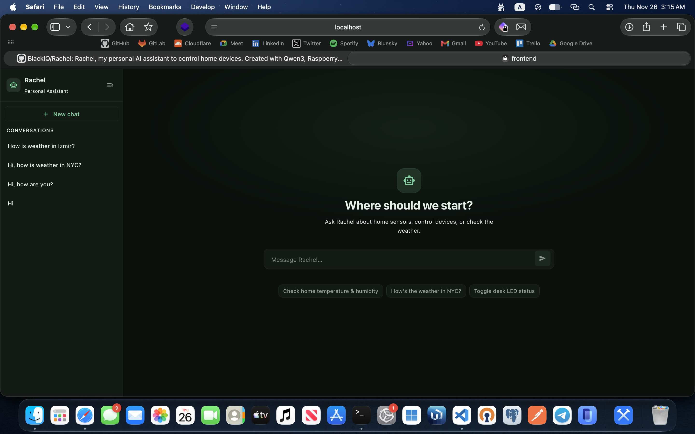
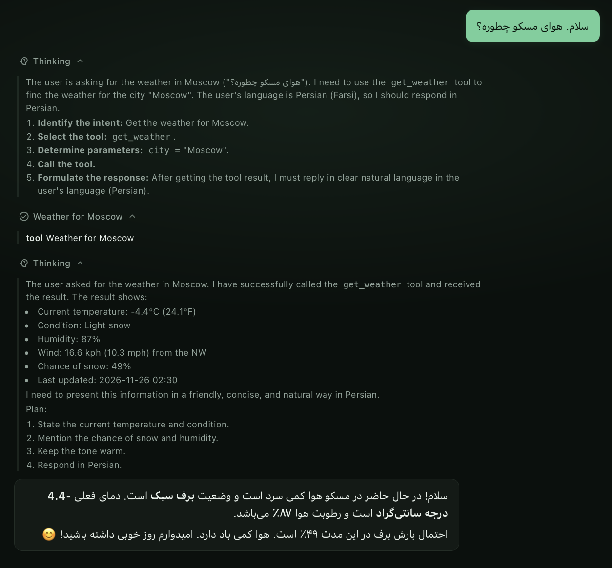
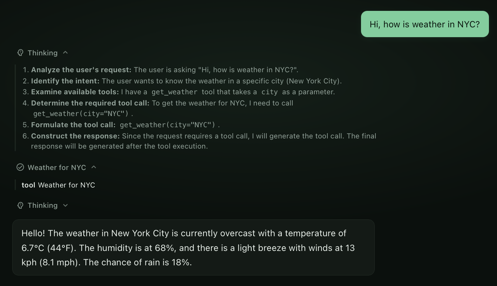
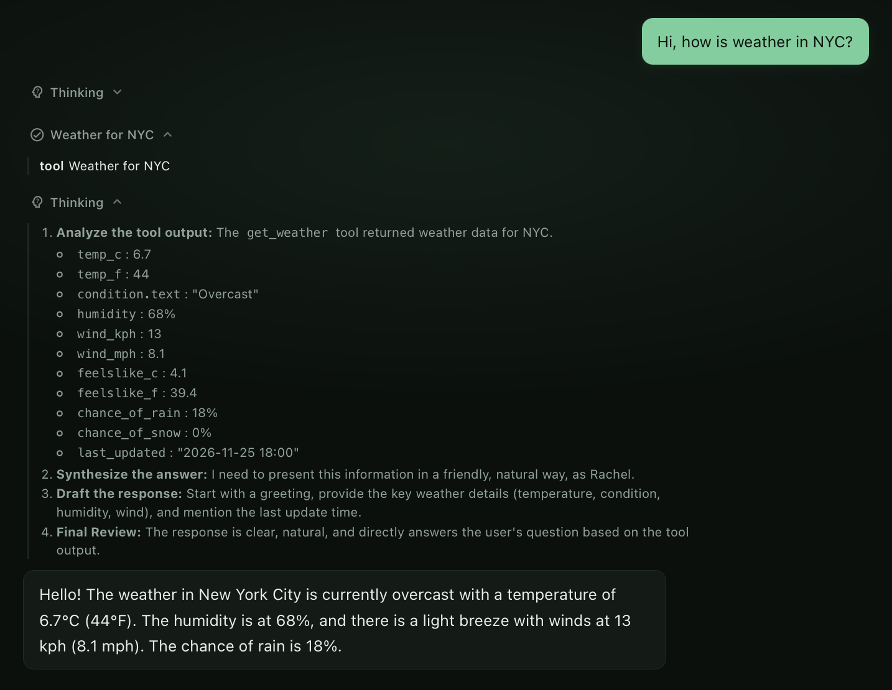

# Rachel

**Rachel** is a personal AI assistant that talks to real home hardware.

She runs locally with **Ollama** (Qwen3, but customized), a **Gin backend**, a **React.js frontend**, and talks to a **Raspberry Pi Pico** over Wi‑Fi for hardware communication.

> Bringing the old Rachel back — this time as a real agent.

## A long story

**Rachel** is not a new idea.

The first public code goes back to **2020** ([NewRachel](https://github.com/BlackIQ/NewRachel)).
Before that, work on the assistant had already started around **2019**.
There was a separate core package ([RachelCore](https://github.com/BlackIQ/RachelCore)),
and an archived early line ([OldRachel](https://github.com/BlackIQ/OldRachel)).

Years later, this repo brings her back, local models, real hardware, and a full stack, but the name and the goal are the same: **A personal assistant that actually helps**.

## Screenshots

| Chat & tools                        | Home empty state              | Persian conversation                | Thinking                                                                          |
| ----------------------------------- | ----------------------------- | ----------------------------------- | --------------------------------------------------------------------------------- |
|  |  |  |   |

## Architecture

| Layer        | Stack                                            | Role                                  |
| ------------ | ------------------------------------------------ | ------------------------------------- |
| **Frontend** | React.js, Vite, MUI                              | User interface, chats, tool summaries |
| **Backend**  | Gin, GORM, SQLite                                | API, chat storage (agent loop soon)   |
| **Firmware** | MicroPython, Microdot                            | Control devices, lights and sensors   |
| **Hardware** | Pico 2 W, MicroPython, Microdot                  | Communicating with devices            |
| **MCP**      | Model Context Protocol (Streamable HTTP / STDIO) | Tools server (hardware + weather)     |
| **LLM**      | Ollama, Qwen3:4B (`rachel-1.5:4b`)               | Reasoning & tool selection            |

## Features

- Multi-turn chat with history stored in SQLite
- Tool calling for home sensors, LEDs, Pico memory, and weather
- Light / dark theme following the system
- Persian (and other languages) — model replies in the user’s language
- Soft-delete chats, rename from the sidebar menu

### Tools

- **get_home_temperature**: Temperature & humidity from DHT11 on the Pico
- **get_pico_resources**: Free / allocated RAM on the Pico
- **turn_led_on**: Turn LED on
- **turn_led_off**: Turn LED off
- **turn_relay_on**: Turn Relay on
- **turn_relay_off**: Turn Relay off
- **get_weather**: Get real-time weather from [WeatherAPI](https://www.weatherapi.com)

Each major package has its own README with setup details:

- [Backend README.md](README.Backend.md)
- [Frontend README.md](frontend/README.md)
- [MCP Server Repository](https://github.com/BlackIQ/Rachel-MCP)
- [Firmware Repository](https://github.com/BlackIQ/Rachel-Firmware)

## Setup

### 1. Ollama model

Install it first. Then:

```bash
ollama create rachel-1.5:4b -f Modelfile
```

### 1. Pico Firmware

Follow details at [Firmware Repository](https://github.com/BlackIQ/Rachel-Firmware)

### 2. MCP Server

Follow details at [MCP Server Repository](https://github.com/BlackIQ/Rachel-MCP)

### 3. Backend

Follow details at [Backend README.md](README.Backend.md)

### 4. Frontend

Follow details at [Frontend README.md](frontend/README.md)

---

Made with ❤️ by [Amirhossein Mohammadi](https://amirhossein.info)
